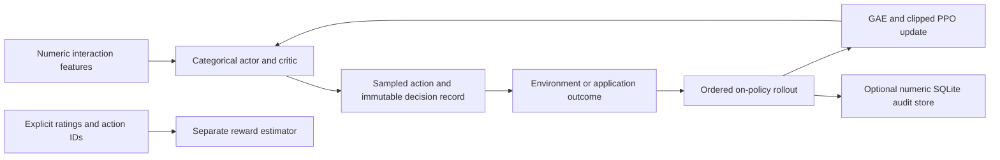

# Feedback Policy Learning

**A PyTorch study of feedback-driven categorical routing: actor–critic networks, on-policy PPO, generalized advantage estimation, explicit reward-model training, and auditable numeric trajectories.**

This repository extracts the reinforcement-learning work from a larger privately developed assistant system into an independent, anonymized engineering study. The public boundary contains the learning components and reproducible checks. Customer applications, conversation histories, account configuration, private datasets, model weights, external messaging, and commercial service identities are excluded.

The problem is a policy decision: given a numeric description of the current interaction, choose one of a fixed set of routing actions and learn from an external outcome. The policy does not generate language. Its probability for an action is not a calibrated measure of answer correctness or user satisfaction.

**Availability:** proprietary source for portfolio inspection. All rights reserved; no general permission to use, modify, redistribute or deploy is granted. See [LICENSE](LICENSE). This is not an MIT or Apache release.

## Engineering scope

The central contribution is the separation between collection, learning, feedback estimation and persistence. Each sampled decision records its exact categorical action ID, behavior-policy log probability, critic value and policy version. Those values remain fixed throughout a PPO update. A completed update advances the policy version, so an old rollout cannot silently become an on-policy training batch again.

The actor and critic retain the two-hidden-layer MLP structure of the original study. The actor emits logits for a categorical action space; the critic estimates a scalar return. A separate state/action reward estimator can be trained on explicitly supplied ratings. Creating a learner does not start training, access a network, create a database or download a model.



## Components

| Component | Responsibility |
| --- | --- |
| `policy_learning/networks.py` | Actor, critic and sigmoid reward-estimation MLPs. |
| `policy_learning/core.py` | Configuration validation, sampled decisions, observations, GAE, PPO, explicit supervised reward fitting and checkpoints. |
| `policy_learning/storage.py` | Opt-in SQLite persistence of numeric rollouts using parameterized queries. |
| `experiments/synthetic_routing.py` | Seeded CPU learning check with an independently generated test set and explicit baselines. |
| `tests/test_policy.py` | Regression tests for action accounting, behavior probabilities, episode boundaries, stale data, checkpoints and storage. |
| `docs/methodology.md` | Mathematical contracts, evaluation protocol and the boundary between synthetic results and application evidence. |
| `docs/extraction-notes.md` | What was preserved, corrected and intentionally excluded from the larger system. |

## Policy and rollout contract

`Config` defaults to 128 numeric state features, eight categorical actions and 256 hidden units per layer. Dimensions are configurable; they are not assertions about a particular customer deployment. The original feature encoder used message length, word count, a supplied emotion score, context length and route one-hot features followed by zero padding. It was not a semantic text embedding. This extracted module takes numeric features explicitly, leaving feature definition and consent-controlled data handling to the integrating application.

Training action selection samples from the categorical actor. Evaluation selects the maximum-logit action deterministically. Evaluation decisions are rejected by the training interface because greedy decisions are not samples from the recorded categorical behavior policy.

Each `Transition` contains a `Decision`, an external scalar reward, a next-state value, and separate `terminated` and `truncated` flags. A true terminal state has no value bootstrap. A time-limit truncation bootstraps from the next-state value but cuts advantage propagation across the episode boundary. Rollouts must be ordered transitions from a single environment; interleaved vectorized environments are not implemented.

PPO uses the recorded log probability to form the importance ratio, normalized GAE advantages, a clipped policy surrogate, MSE value loss, an entropy term and gradient clipping. Training metrics include policy loss, value loss, entropy, approximate KL, clipping fraction and the gradient norm before clipping. Full-rollout updates are used; minibatch scheduling and KL early stopping are not implemented.

## Reward estimation

The optional reward model concatenates state features and a categorical one-hot action, then predicts a rating in `[0, 1]`. `fit_reward_model` validates alignment, action IDs and rating ranges before optimization. It is a separate supervised operation: it does not change the actor, automatically replace environment rewards, infer human satisfaction, or consume production conversations.

The original integrated study combined changes in an externally estimated emotion score, an optional satisfaction signal and a confidence-based term. The extracted PPO interface accepts externally defined rewards instead. Policy confidence is not used as its own quality reward. Automatic sentiment or emotion labels, if added by an application, must be distinguished from explicit human feedback and independently validated.

## Reproducing the author-side checks

The following commands document the author's validation workflow and separately authorized evaluations. They do not grant a software-use license. Python 3.11 or newer and the CPU PyTorch dependency in `requirements.txt` are sufficient; no API keys, CUDA, database server, provider account or pretrained model download is needed.

```bash
python -m venv .venv
.venv/bin/python -m pip install -r requirements.txt
.venv/bin/python -m unittest discover -s tests -v
.venv/bin/python experiments/synthetic_routing.py --output artifacts/synthetic-routing.json
```

Windows PowerShell:

```powershell
py -3.11 -m venv .venv
& ./.venv/Scripts/python.exe -m pip install -r requirements.txt
& ./.venv/Scripts/python.exe -m unittest discover -s tests -v
& ./.venv/Scripts/python.exe experiments/synthetic_routing.py --output artifacts/synthetic-routing.json
```

The tests exercise algorithm contracts, rather than counting imports or checking that a demo prints a value. In particular, changing a recorded behavior log probability changes the measured ratio/KL, updating a rollout makes it stale, and truncation differs from a terminal transition in the expected return calculation.

## Small integration example

This complete example constructs a three-action policy, collects sixteen independent one-step observations, performs one PPO update and returns a deterministic decision. The reward rule is deliberately synthetic.

```python
import torch
from policy_learning import Config, PolicyLearner

torch.manual_seed(19)
learner = PolicyLearner(Config(state_dim=4, action_dim=3, hidden_dim=32))
rollout = []
for index in range(16):
    features = [index / 16.0, 0.2, 0.3, 0.4]
    decision = learner.decide(features, training=True)
    reward = float(decision.action_id == index % 3)
    rollout.append(learner.observe(decision, reward, features, terminated=True))
metrics = learner.update(rollout)
decision = learner.decide([0.5, 0.2, 0.3, 0.4])
print(metrics)
print(decision.action_id)
```

## Evaluation and evidence

The included experiment is a one-step contextual routing task with twelve independent numeric features and four actions. The target is the index of the largest of the first four features. Correct routing receives `1`, otherwise `0`. It checks that the implementation can learn a known signal; it is intentionally much simpler than a dialogue environment.

Training and test examples come from different seeded generators. A training-majority action and a uniform-random policy are evaluated on the same held-out examples as PPO. A known-rule oracle is included to show the task's achievable ceiling. The test set is never passed to a policy or reward-model update. Complete per-seed results and the actual runtime environment are recorded in [artifacts/synthetic-routing.json](artifacts/synthetic-routing.json).

Recorded author-side run: 4,096 training examples and 2,048 held-out examples per seed, CPU PyTorch 2.9.1. The current dependency pin is CPU PyTorch 2.15.0; its unit suite and shorter learning check are checked by CI on Python 3.11 and 3.12. The table reports the recorded full run, not a newly measured 2.15.0 result.

| Seed | PPO mean reward | Uniform random | Training-majority action | Known-rule oracle |
| --- | --- | --- | --- | --- |
| 7 | 0.9175 | 0.2510 | 0.2651 | 1.0000 |
| 19 | 0.8984 | 0.2500 | 0.2373 | 1.0000 |
| 43 | 0.9243 | 0.2524 | 0.2505 | 1.0000 |

These are synthetic implementation results. They do not establish better conversations, valid emotion inference, calibrated confidence, business uplift, preference alignment or production readiness. An application study would require an approved task and dataset, conversation-group or chronological splits, independently defined outcomes, logged behavior propensities for any off-policy analysis, reward ablations, uncertainty estimates and failure analysis.

## Persistence and operational boundary

SQLite storage is created only by explicitly constructing `TrajectoryStore`. The schema stores numeric features, action IDs, behavior probabilities, values, rewards, episode flags and policy versions. It has no fields for raw messages, response text, user IDs, customer identities or credentials. Numeric features can still carry sensitive information in a real integration, so the public experiment uses generated data exclusively.

Checkpoints contain network and optimizer state, configuration and the policy version. Loading uses `torch.load(..., weights_only=True)`. They do not capture RNG state, pending rollout state or environment state; exact continuation requires an application-level run manifest. Database and weight files are ignored by Git and are not included in the source release.

## Attribution and limitations

The actor, critic and reward-estimator architecture originated in the author's larger routing/RL system. The extraction includes substantial correctness changes documented in [extraction notes](docs/extraction-notes.md). It is not a publication of the complete commercial assistant or a claim that a production RL policy has been validated.

The original experimental transformer declaration is excluded: a layer declaration without a validated return-conditioned training/evaluation protocol is not presented as an implemented Decision Transformer result. There is no claimed meta-learning result, foundation-model fine-tuning, language-model RLHF pipeline or quantum component in this repository.

For reuse or deployment, a separate written agreement with the copyright holder is required. Dependencies retain their own licenses.
